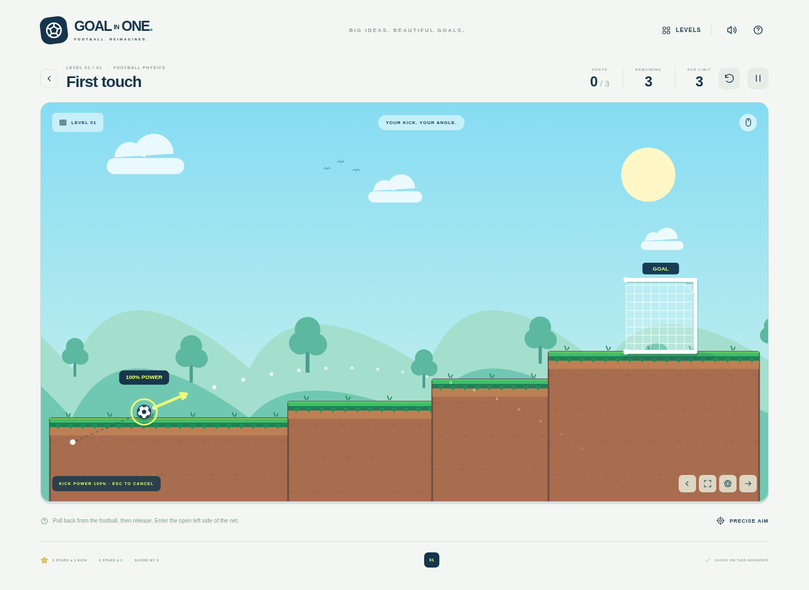

# Football remake: design and reference audit

## Source of truth

The user's nine-page **Goal_In_One_Codex_Remake_Brief.pdf** was read in full, including its annotated scene composition and ten level schematics. It identifies the inspiration as **Phantasmagor's Goal In One (2006), Newgrounds portal 324126**: a side-view football launch puzzle with goals and a limited number of shots.

The PDF explicitly labels its drawings as **illustrative concept diagrams, not original screenshots**. The remake follows their scene structure and gameplay requirements; it does not claim to recreate the original ten levels or original art exactly.

## External references attempted

All six links embedded in the PDF were requested on 20 October 2026. Every request returned HTTP 403 in this environment. Neither original screenshot could be viewed, and the original Flash gameplay was not personally verified. These failures were reported during development; they were not treated as permission to guess a different genre.

| Reference                    | URL                                                                 | Result                 |
| ---------------------------- | ------------------------------------------------------------------- | ---------------------- |
| Newgrounds release           | https://www.newgrounds.com/portal/view/324126                       | HTTP 403; not viewable |
| Armor Games instructions     | https://armorgames.com/goal-in-one-game/363                         | HTTP 403; not viewable |
| POG listing                  | https://www.pog.com/game/goal-in-one-12353                          | HTTP 403; not viewable |
| Original POG screenshot      | https://www.pog.com/assets/game-thumbs/c4/goal-in-one-12353.webp    | HTTP 403; not viewable |
| Original Miniplay screenshot | https://www4.minijuegosgratis.com/v3/games/thumbnails/6481_7_sq.jpg | HTTP 403; not viewable |
| Y8 listing                   | https://www.y8.com/games/goal_in_one                                | HTTP 403; not viewable |

## Audit and reuse

Reused: Matter.js integration, fixed 120 Hz physics, Pointer Events and pointer capture, drag power clamping, browser test tooling, menu/modal structure and focus handling, local-storage validation, synthesized audio infrastructure, Vite/TypeScript, and GitHub Pages publishing.

Replaced: entity identity and art, cup capture, all ten layouts, unlimited-stroke rules, star thresholds, flat viewport assumptions, terrain palette, copy, navigation, and completion feedback. Football scores use a new versioned save key; obsolete scores do not count for redesigned levels. The old sound preference is retained.

## Visual baseline

The first implementation was **First touch**, with a black-and-white football, a visible elevated mesh net, hard-edged grass-topped steps, and a kick-direction arrow. It was captured and inspected before implementing the other nine layouts. A real mouse drag/release completed that first level.

The completed game's menu, elevated aiming scene, flight, and per-level goal screenshots are in [evidence](evidence/). All art is drawn in Canvas or SVG; no outside graphics or fonts are downloaded.

## Rules and modern implementation decisions

- A 12-unit-radius black-and-white football has gravity, restitution, friction, and angular motion. It is a small, distinct object in a side-view platform world.
- Press the football and drag backward. Release applies a capped kick; a six-unit dead zone, Escape, pointer cancellation, and lost capture cancel safely.
- Next kick requires both linear speed below 0.18 and angular speed below 0.025 for 42 physics steps (0.35 seconds). A ball disturbed by scenery returns to the moving state.
- The net faces left. The **whole football** must cross its open front plane from left to right, with its entire circular extent inside the mouth's vertical bounds. Position is interpolated at the crossing. High-speed discontinuities, nearby balls, starting inside, and back/roof contacts alone cannot score.
- The crossbar, back post, and mouth end caps collide. The side-profile mouth itself is open, not an invisible wall. The visible white mesh and frame share the same world coordinates as the physics.
- A valid entry starts a short net capture/rustle animation before success. No proximity disappearance or arbitrary rectangular goal trigger is used.
- PAR is a **hard kick budget**. The last legal kick can score while it is moving. If it comes to rest or goes out of play without scoring, the level fails. Failing never improves a saved score.
- Water/out-of-world attempts consume their kick, then return to the last kick's start when a budget remains. Retry recreates all physics, obstacle phases, camera, counters, and particles.
- Three-star and two-star kick thresholds are explicit level data, strictly ordered and below the maximum budget. Legal tested routes meet every three-star target.
- The camera smoothly follows the ball on wide levels. Overview, pan, and follow controls allow scouting. Portrait view uses a closer 900-unit viewport. Camera motion is locked during aiming and pause; coordinate transforms remain shared with input.
- Pause/help stop physics. Audio starts only after interaction. Reduced motion disables particles and decorative animation while retaining essential ball/camera motion.

These are modern engineering choices guided by the PDF, not claims about undocumented details of the Flash implementation.
